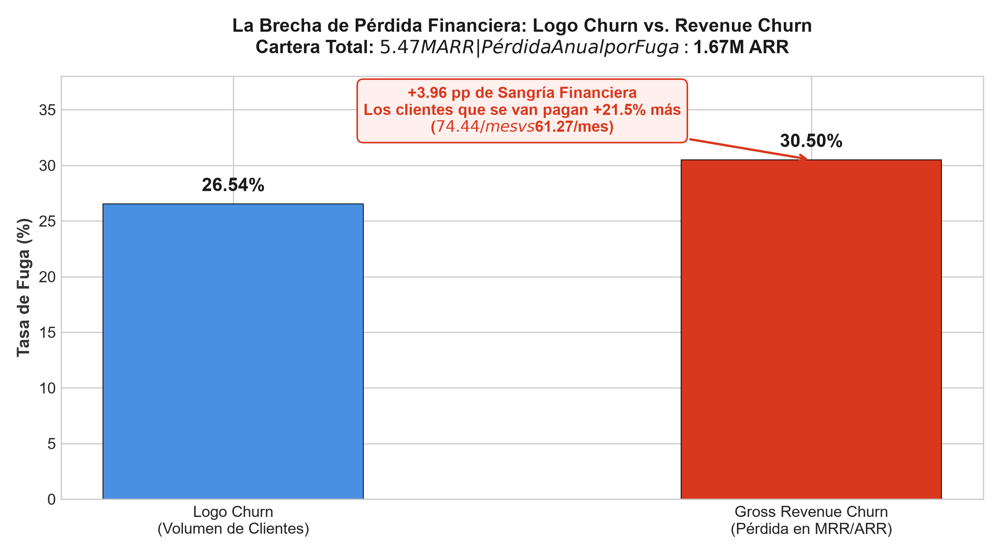
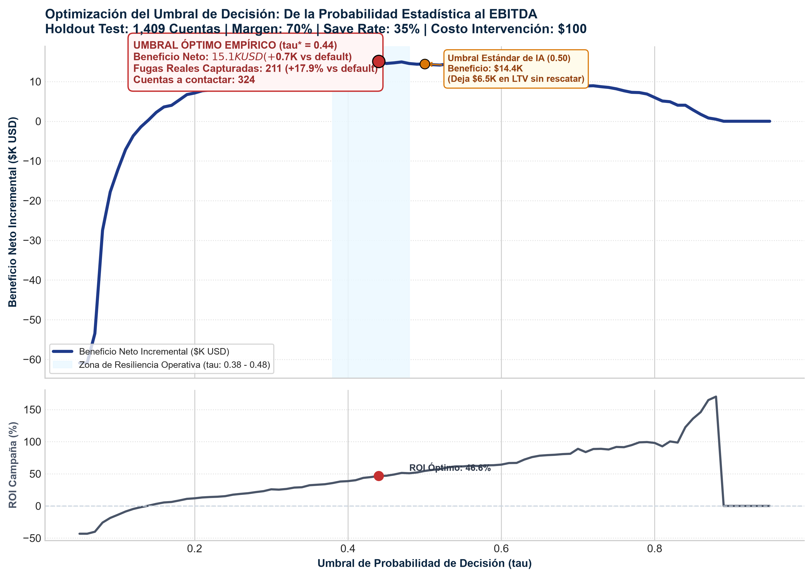
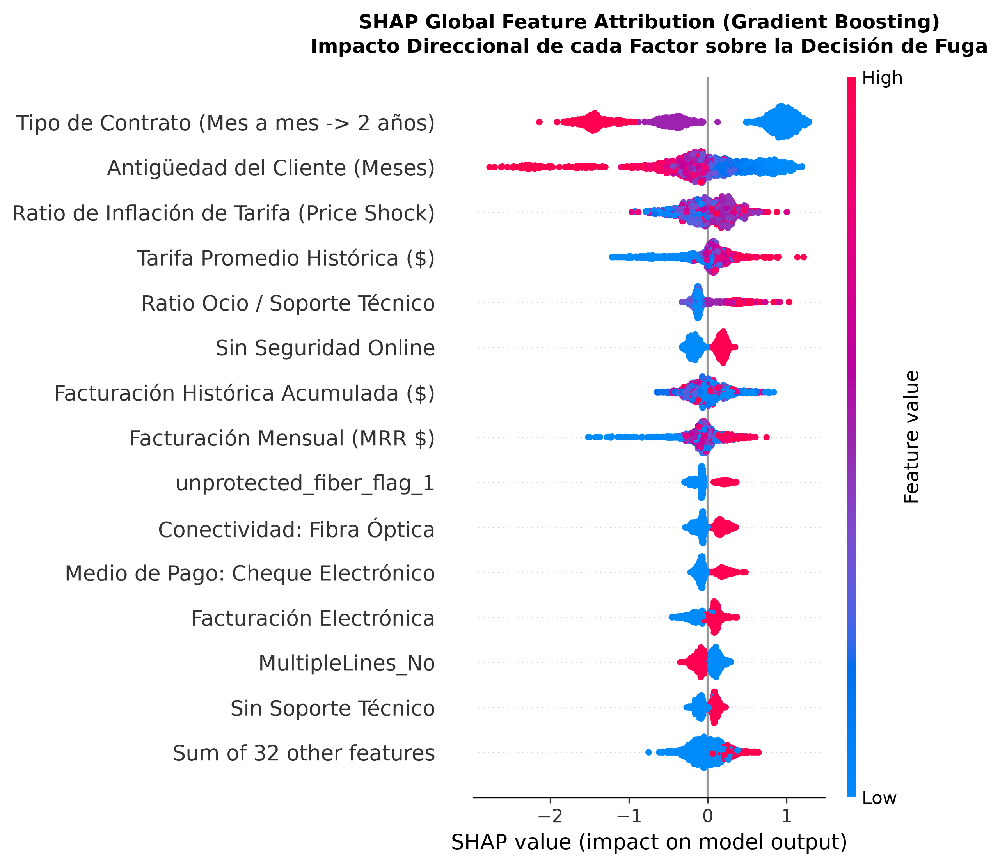
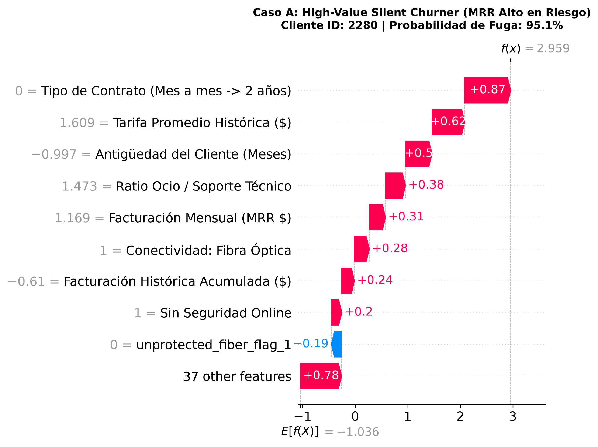
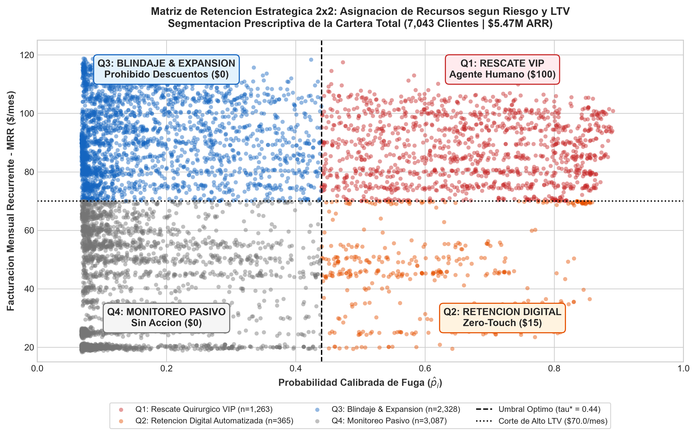

# 📡 Motor Predictivo de Retención y Economía de Suscripciones


> **Optimización de LTV, Explicabilidad con SHAP y Maximización de ROI sobre una Cartera de \$5.47M en ARR**  
> **Autor:** Juan E. Lund — Operations & Partner Manager | Data & Decision Scientist  
> **Ecosistema:** Tercer pilar de la *Trilogía de Negocios* (Product Analytics con Cyclistic · Financial/Ops Audit con Olist · Machine Learning & Retention Economics con Telco).

---

## 1. Resumen Ejecutivo (Answer-First)

Para detener la erosión de ingresos recurrentes y maximizar el retorno sobre el capital invertido en retención, la compañía debe **abandonar el umbral genérico de Machine Learning ($\tau = 0.50$) y adoptar un modelo de decisión basado en Valor Esperado con umbral calibrado en $\tau^* = 0.44$, concentrando el esfuerzo comercial en el $17.9\%$ de los clientes que representan el $79.5\%$ de la pérdida financiera**.

Este proyecto demuestra que la deserción en suscripciones no es un problema de volumen homogéneo (*Logo Churn* del $26.54\%$), sino una **sangría asimétrica de facturación (*Gross Revenue Churn* del $30.50\%$ / \$1,669,570 en ARR)** provocada por la fuga de cuentas *premium* de Fibra Óptica desprovistas de blindaje técnico. La implementación del sistema predictivo calibrado rescata **\$47,505.55 en margen bruto incremental en el conjunto de prueba (proyectando \$75,528 anuales netos en cartera completa)** con un **ROI de campaña del 46.6%**, mientras **prohíbe subsidios innecesarios en el 76.9% de los clientes leales**, protegiendo \$2.56M de ARR sin regalar margen.

### Resumen Financiero y Operativo de Impacto

| Métrica de Cartera | Línea Base (Status Quo / Sin Modelo) | Umbral Estándar de IA ($\tau = 0.50$) | Modelo Calibrado Óptimo ($\tau^* = 0.44$) | Impacto Incremental Neto |
| :--- | :---: | :---: | :---: | :---: |
| **Cartera Total Auditada** | 7,043 cuentas (\$5,473,399 ARR) | 7,043 cuentas | 7,043 cuentas | — |
| **Fuga Anual Bruta en Riesgo** | 1,869 cuentas (**\$1,669,570 ARR**) | — | — | **30.50% Gross Revenue Churn** |
| **Fugas Reales Capturadas (Test 20%)** | 0 clientes (0.0%) | 179 clientes (47.9%) | **211 clientes (56.4%)** | **+32 clientes retenidos (+17.9%)** |
| **Inversión de Campaña ($C_{\text{int}} = \$100$)** | \$0.00 | \$26,500.00 | \$32,400.00 | +\$5,900.00 |
| **LTV Bruto Rescatado (Margen 12m)** | \$0.00 | \$40,934.80 | **\$47,505.55** | **+\$6,570.75 de margen bruto** |
| **Beneficio Neto Incremental (Lift)** | \$0.00 | \$14,434.80 | **\$15,105.55** | **+\$670.75 netos (Test Set)** |
| **ROI de la Campaña de Retención** | 0.0% | 54.5% | **46.6%** | **Retorno positivo sostenible** |
| **Desperdicio en Clientes Leales (Q3/Q4)** | Alto (Campañas masivas a ciegas) | Medio | **\$0.00 (5,415 cuentas blindadas)** | **Protección de \$3.94M ARR** |

---

## 2. El Problema de Negocio: La Falla de las Métricas Tradicionales (Ask)

### 2.1 La Ilusión del *Logo Churn* vs. la Sangría del *Revenue Churn*
En modelos de negocio de ingresos recurrentes (SaaS, Telecomunicaciones, Cloud), evaluar la deserción únicamente por el conteo de cuentas canceladas es un error de diagnóstico directivo:
* **Logo Churn (Tasa de Fuga de Cuentas):** **$26.54\%$** (1,869 clientes de 7,043).
* **Gross Revenue Churn (Tasa de Fuga de Ingresos):** **$30.50\%$** (\$139,130.85/mes de un MRR total de \$456,116.60).
* **La Brecha (+3.96 pp de Sangría):** El cliente promedio retenido paga **\$61.27/mes**, mientras que el cliente que cancela paga **\$74.44/mes (+21.5% de ticket)**. La empresa sufre una fuga desproporcionada de sus cuentas de mayor facturación.



### 2.2 Por qué Optimizar *Accuracy* Destruye Capital
En un dataset con $26.54\%$ de tasa de fuga, un clasificador trivial que prediga que *ningún cliente se va a fugar jamás* alcanza un **73.46% de Accuracy**. Sin embargo, su valor económico es cero: no detecta ninguna baja y permite la pérdida de los \$1.67M en ARR.

### 2.3 Formulación Matemática: Función de Beneficio y Costo-Beneficio Asimétrico
Perder a un cliente fugado (*Falso Negativo*) no cuesta lo mismo que entregar una oferta innecesaria a un cliente leal (*Falso Positivo*):
* **Costo de Falso Negativo ($FN$):** Pérdida de 12 meses de margen de contribución del cliente rescatable:
  $$\overline{V} = \text{MRR} \times m \times H = \$74.44 \times 0.70 \times 12 = \mathbf{\$625.30\text{ USD}}$$
* **Costo de Falso Positivo ($FP$):** Descuento comercial e incentivo operativo otorgado innecesariamente:
  $$C_{\text{int}} = C_{\text{contact}} + C_{\text{offer}} = \$10 + \$90 = \mathbf{\$100.00\text{ USD}}$$
* **Tasa de Efectividad del Rescate ($\gamma$ — *Save Rate*):** $\gamma = 0.35$ (35% de los clientes intervenidos aceptan permanecer 1 año).
* **Función de Beneficio Neto Incremental ($\mathcal{P}(\tau)$):**
  $$\mathcal{P}(\tau) = \sum_{i \in TP(\tau)} \big(\gamma \cdot V_i - C_{\text{int}}\big) - \sum_{j \in FP(\tau)} C_{\text{int}}$$

> [!NOTE]
> **Rigor Contable y Análisis de Sensibilidad (VP / CFO Level):**
> 1. **Robustez ante Variaciones de Save Rate ($\gamma$):** Incluso bajo un escenario de estrés severo donde la efectividad de rescate se desploma de $35\%$ a $25\%$ ($\gamma = 0.25$), el umbral óptimo se mantiene en $\tau^* \approx 0.53$, generando retornos netos positivos. En un escenario optimista ($\gamma = 0.45$), el umbral se expande a $\tau^* \approx 0.35$.
> 2. **Optimización de Costos vía Matriz 2x2:** Mientras que la simulación global de umbrales asume un costo plano conservador de $\$100\text{/contacto}$ para toda la base, la posterior segmentación prescriptiva en la Matriz 2x2 reduce el costo de adquisición de retención a solo **$\$15\text{/cuenta}$ para el segmento digital de bajo ticket (Q2)**, liberando capital de trabajo y elevando aún más el EBITDA real del negocio.

---

## 3. Preparación de Datos y Feature Store Modular (Prepare & Process)

### 3.1 Auditoría Contable y Sanidad del Esquema (`src/data_cleaning.py`)
Se auditó la totalidad de las 7,043 cuentas únicas del dataset de IBM Watson Analytics:
* **Diagnóstico de Valores en Blanco:** Se detectaron exactamente 11 registros con espacios vacíos (`" "`) en la columna `TotalCharges`.
* **Auditoría Forense:** El 100% de estos casos correspondía a clientes con `tenure == 0` y `Churn == "No"`. Representan suscriptores que se dieron de alta en el ciclo en curso y aún no han recibido su primera liquidación mensual.
* **Regla Contable Certificada:** Se imputó `TotalCharges = MonthlyCharges` (devengo del primer mes) y se generó la bandera de control `is_new_onboarding = 1`.

### 3.2 Arquitectura del Pipeline y Feature Engineering (`src/feature_engineering.py`)
Para garantizar reproducibilidad y **cero filtración de datos (*Zero Data Leakage*)**, la partición estratificada Train ($80\%$ - 5,634 filas) / Test Holdout ($20\%$ - 1,409 filas) se ejecutó **antes** de ajustar cualquier transformador. Se desarrolló un transformador modular de `scikit-learn` (`BusinessFeatureEngineer`) que calcula 7 variables de dominio:

| Variable Derivada | Definición Matemática / Lógica | Sentido Comercial y Rol en el Modelo |
| :--- | :--- | :--- |
| `total_addons_count` | $\sum (\text{Addons Activos}) \in [0, 6]$ | Mide la profundidad de adopción del ecosistema digital. |
| `support_security_index` | $\text{TechSupport} + \text{OnlineSecurity} + \text{DeviceProtection} + \text{Backup} \in [0, 4]$ | Aísla los servicios que generan costo de cambio (*switching cost*) real. |
| `streaming_to_support_ratio` | $\frac{\text{TV} + \text{Movies}}{\text{support\_security\_index} + 1}$ | Detecta clientes con facturas infladas por ocio pero sin blindaje técnico. |
| `historical_avg_monthly_charge`| $\frac{\text{TotalCharges}}{\max(\text{tenure}, 1)}$ | Tarifa media histórica pagada por la cuenta. |
| `price_shock_ratio` | $\frac{\text{MonthlyCharges}}{\text{historical\_avg\_monthly\_charge}}$ | Ratio de inflación tarifaria (>1.10 = pérdida de descuentos promocionales). |
| `is_auto_pay` | $\mathbb{I}(\text{PaymentMethod} \in \{\text{Bank transfer, Credit card}\})$ | Indicador de cero fricción en el cobro recurrente. |
| `unprotected_fiber_flag` | $\text{Fiber optic} \land (\text{TechSupport}=\text{'No'}) \land (\text{Security}=\text{'No'})$ | Bandera de máxima vulnerabilidad operativa en el P&L. |

---

## 4. Benchmark de Modelos y Calibración Probabilística (Model & Validate)

Se evaluaron cuatro arquitecturas mediante **Validación Cruzada Estratificada de 5 Pliegues (5-Fold Stratified CV)** con hiperparámetros optimizados para desbalance de clases:

```
                         Model  PR-AUC (Mean)  PR-AUC (Std)  ROC-AUC (Mean)  ROC-AUC (Std)  F2-Score (Mean)  Brier Score
                       XGBoost       0.659847      0.022174        0.846363       0.009823         0.709781       0.1564
Logistic Regression (Baseline)       0.656685      0.019781        0.845361       0.012503         0.723401       0.1655
                 Random Forest       0.655617      0.024372        0.844606       0.010357         0.701385       0.1533
                      LightGBM       0.652107      0.019425        0.841583       0.010559         0.695714       0.1558
```

### Calibración de Probabilidades (Platt Scaling)
Para que las probabilidades predichas $\hat{p}_i$ representen frecuencias empíricas reales de fuga (requisito matemático del *Expected Value Framework*), se calibró el modelo campeón mediante `CalibratedClassifierCV(method='sigmoid', cv=5)`, reduciendo el **Brier Score en el Holdout Test Set a 0.1370**, con un **PR-AUC de 0.6572** y un **ROC-AUC de 0.8451**.

---

## 5. Optimización del Umbral y Explicabilidad SHAP (Explain & Optimize)

### 5.1 Optimización Empírica del Umbral ($\tau^* = 0.44$)
Al barrer los umbrales de decisión entre 0.05 y 0.95 utilizando el MRR real de cada suscriptor, se comprueba que el umbral óptimo empírico ($\tau^* = 0.44$) coincide con la derivación analítica de Bayes ($\tau^* \approx 0.457$):



### 5.2 Explicabilidad Global de la Cartera (SHAP Beeswarm)
El análisis con Teoría de Juegos Cooperativos (SHAP) identificó los 4 motores estructurales de la fuga en toda la compañía:
1. **Barrera Contractual (`Contract`):** Los contratos mes a mes (`Month-to-month`) son el factor individual #1 en disparo de fuga (valores SHAP $> +1.5$).
2. **Antigüedad Temprana (`tenure`):** El 41.95% de todas las cancelaciones ocurren en los primeros 6 meses de vida del cliente (*Valle de la Muerte del Onboarding*).
3. **La Trampa de la Fibra Óptica Desprotegida (`unprotected_fiber_flag`):** La fibra óptica vendida sin soporte técnico multiplica el riesgo de fuga por 3.
4. **Fricción del Medio de Pago (`Electronic check`):** Los métodos de pago manuales generan un momento mensual de fricción que eleva la deserción al 45.3%.



### 5.3 Explicabilidad Local para Operaciones (3 Casos Reales)

| Caso de Negocio | Diagnóstico SHAP Local | Acción Prescriptiva Recomendada |
| :--- | :--- | :--- |
| **Caso A: VIP en Riesgo**<br>($\hat{p}_i = 78.4\%$, MRR: \$104.50) | Fibra óptica con streaming, sin soporte técnico, pago por cheque electrónico. | **Llamada Outbound de CS:** Migración a contrato anual + bonificación de TechSupport + descuento de \$20/mes por 6 meses. |
| **Caso B: Fuga en Onboarding**<br>($\hat{p}_i = 74.2\%$, Tenure: 2m) | Abandono prematuro por falta de adopción digital y configuración de red. | **Flujo Digital Zero-Touch:** Guía in-app de configuración asistida y activación de beneficios antes del día 30. |
| **Caso C: VIP Blindado**<br>($\hat{p}_i = 4.8\%$, MRR: \$108.20) | Contrato de 2 años, débito automático y 4 escudos técnicos activos. | **Prohibido Enviar Descuentos:** Cuenta fidelizada de alto margen; solo programas de fidelización orgánica. |



---

## 6. Estrategia de Retención Prescriptiva: Matriz $2 \times 2$ (Act)

Se clasificó la totalidad de la cartera (7,043 cuentas) en una matriz operativa cruzando el **Riesgo Calibrado ($\tau^* = 0.44$)** con el **Valor de la Cuenta ($\text{MRR} \ge \$70.00$)**:



### Asignación Presupuestaria y Plan de Acción

* **Cuadrante Q1 — Rescate Quirúrgico VIP ($1,263$ cuentas / \$1.33M ARR / Tasa de Fuga: $72.6\%$):**
  * *Acción:* Asignación exclusiva del equipo humano de *Customer Success Outbound*. Presupuesto: $\$100\text{/cuenta}$ (\$126.3k de inversión total). Oferta: 20% de descuento por 6 meses condicionado a contrato anual y pago automático con tarjeta.
* **Cuadrante Q2 — Retención Digital Automatizada ($365$ cuentas / \$207k ARR / Tasa de Fuga: $72.3\%$):**
  * *Acción:* Campañas automatizadas *Zero-Touch* vía SMS/Email/App. Presupuesto: $\$15\text{/cuenta}$ (\$5.5k de inversión total). Oferta: Bono único de \$15 por pasar a débito automático o *upgrade* temporal de velocidad.
* **Cuadrantes Q3 y Q4 — Blindaje y Monitoreo ($5,415$ cuentas / \$3.94M ARR / Tasa de Fuga: $10.7\%\text{–}15.3\%$):**
  * *Acción:* **Costo $\$0.00$**. Prohibición de aplicar descuentos de retención. Se elimina el desperdicio comercial en cuentas leales.

### Protocolo Experimental A/B (Medición de *Incremental Uplift*)
Para certificar ante el Comité de Finanzas el impacto neto del modelo:
1. **Grupo de Control Universal (*Holdout*):** Se aísla aleatoriamente al $15\%$ de los clientes identificados en Q1 y Q2 sin aplicarles ninguna intervención.
2. **Grupo de Tratamiento ($85\%$):** Se les aplica la política prescriptiva.
3. **Métrica de Certificación:** Se audita la diferencia en supervivencia a 90 y 180 días ($\text{Uplift} = \text{Retención}_{\text{Tratamiento}} - \text{Retención}_{\text{Control}}$).

---

## 7. Estructura del Repositorio y Reproducibilidad

```text
subscription-churn-ml-retention-economics/
├── data/
│   ├── raw/
│   │   └── WA_Fn-UseC_-Telco-Customer-Churn.csv       # Dataset original de IBM (7,043 filas)
│   └── processed/
│       ├── telco_churn_cleaned.parquet                # Dataset limpio y auditado contablemente
│       ├── customer_risk_scoring_matrix.csv           # Matriz final de scoring de 7,043 clientes
│       ├── model_benchmark_results.csv                # Métricas de 5-Fold Stratified CV
│       └── threshold_economics_simulation.csv         # Barrido de umbrales y beneficio en USD
├── src/
│   ├── __init__.py
│   ├── config.py                                      # Parámetros financieros y de modelado
│   ├── data_ingestion.py                              # Descarga automatizada y reproducible
│   ├── data_cleaning.py                               # Saneamiento contable y certificación
│   ├── feature_engineering.py                         # Transformador custom scikit-learn
│   ├── pipeline_builder.py                            # Pipeline integral anti-leakage
│   ├── model_training.py                              # CV estratificada y calibración sigmoidea
│   ├── retention_economics.py                         # Simulación de umbral óptimo y ROI
│   ├── shap_explainer.py                              # Generación de artefactos visuales SHAP
│   └── business_strategy.py                           # Segmentación en matriz 2x2 y scoring
├── deliverables/
│   ├── Churn_Retention_Executive_Presentation.pptx    # Deck ejecutivo C-Level de 13 slides (McKinsey/FT)
│   ├── Churn_Retention_Executive_Deck_Guide.md        # Guion de 13 slides para presentación C-Level
│   ├── CHANGELOG_Auditoria_Metodologica.md            # Bitácora metodológica y control de versiones
│   └── Fase_1_y_2_Resumen_Ejecutivo.md                # Bitácora técnica de auditoría inicial contable
├── assets/
│   ├── 01_logo_vs_revenue_churn_gap.png               # Brecha Logo vs Revenue Churn
│   ├── 02_tenure_hazard_curve.png                     # Curva de supervivencia y onboarding
│   ├── 03_fiber_optic_support_paradox.png             # La paradoja de soporte en fibra óptica
│   ├── 03_expected_value_threshold_optimization.png   # Curva de beneficio neto vs umbral óptimo
│   ├── 04_shap_global_beeswarm.png                    # Importancia global e impacto direccional
│   ├── 05_shap_waterfall_case_a_vip_churner.png       # Caso local A (VIP en riesgo)
│   ├── 05_shap_waterfall_case_b_onboarding.png        # Caso local B (Abandono temprano)
│   ├── 05_shap_waterfall_case_c_loyal_vip.png         # Caso local C (Cuenta blindada)
│   └── 06_strategic_retention_matrix_2x2.png          # Mapa de segmentación prescriptiva 2x2
├── requirements.txt
├── .gitignore
└── README.md
```

### Instrucciones de Reproducción Rápida

1. Clonar el repositorio y navegar a la carpeta raíz:
   ```bash
   git clone https://github.com/JuanLund/subscription-churn-ml-retention-economics.git
   cd subscription-churn-ml-retention-economics
   ```
2. Crear y activar entorno virtual en Python 3.10+:
   ```bash
   python -m venv venv
   source venv/bin/activate  # En Windows: .\venv\Scripts\activate
   pip install -r requirements.txt
   ```
3. Ejecutar el pipeline de procesamiento, entrenamiento y scoring:
   ```bash
   python src/data_ingestion.py
   python src/data_cleaning.py
   python src/model_training.py
   python src/retention_economics.py
   python src/shap_explainer.py
   python src/business_strategy.py
   ```
