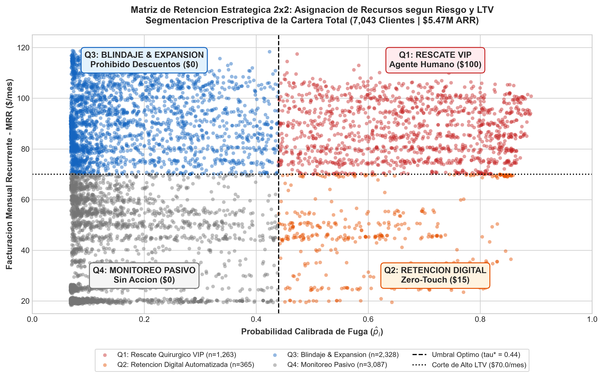
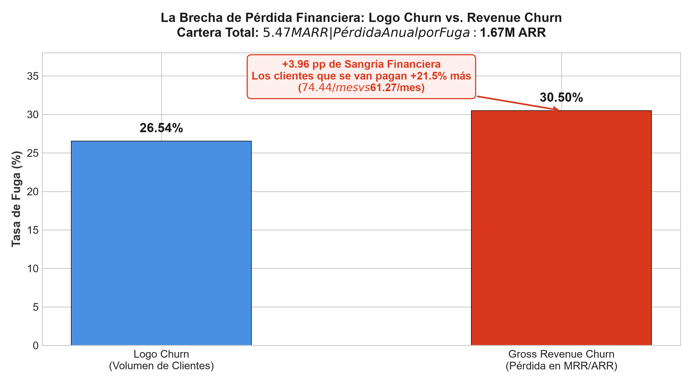
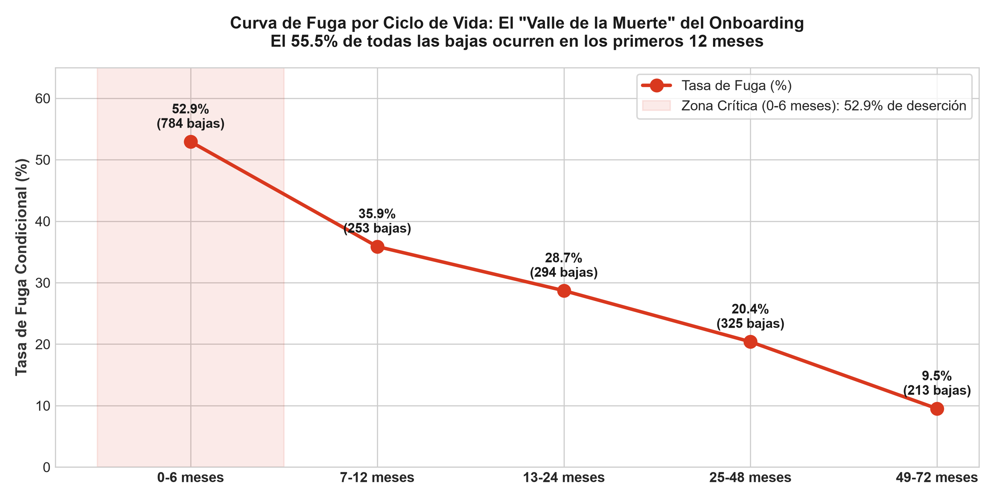
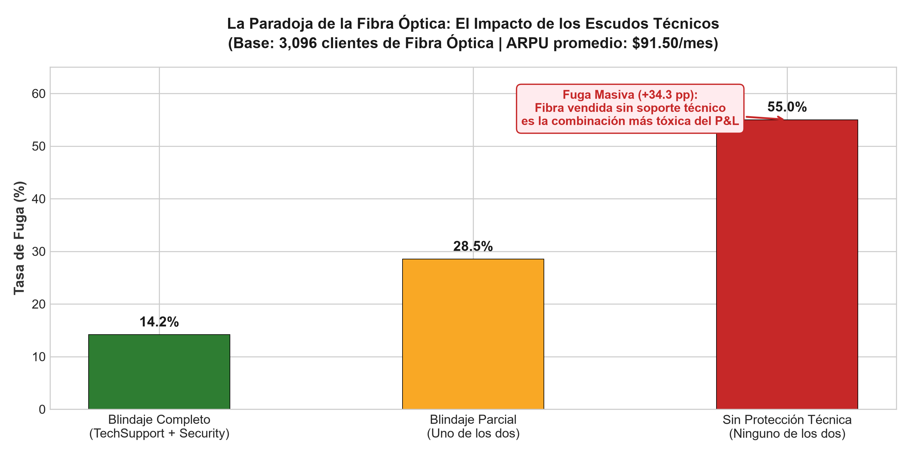
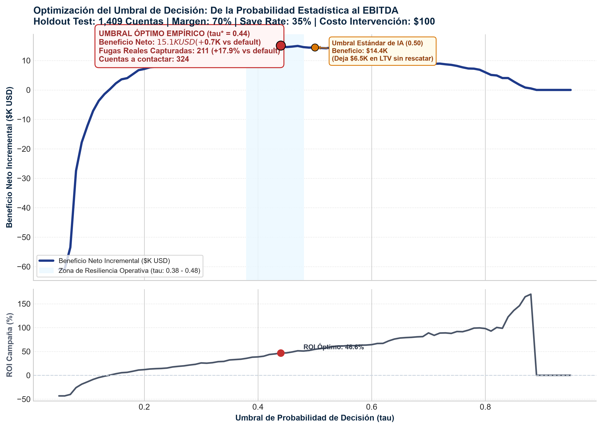
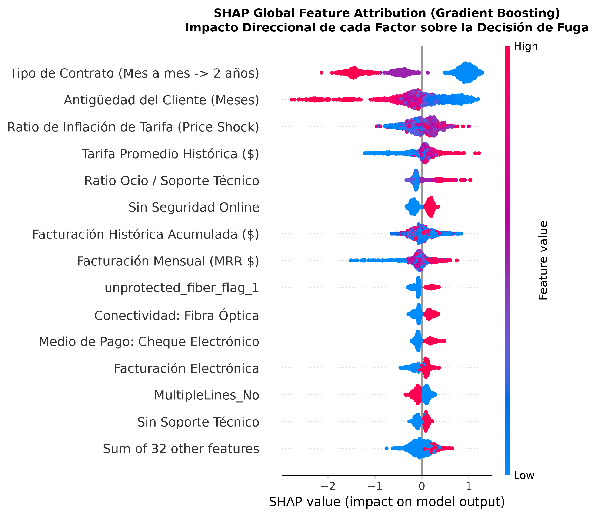
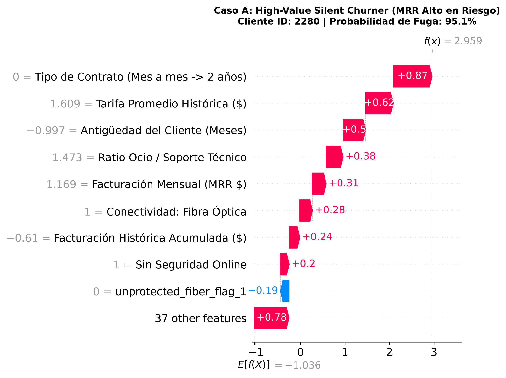

# Por Qué el 90% de los Modelos de Churn Destruyen Dinero (Y Cómo el Machine Learning Calibrado Rescata $47.5K en Margen Bruto)

**Autor:** Juan E. Lund — Operations & Partner Manager | Data & Decision Scientist  
**Lectura estimada:** 8 minutos  
**Tags:** #DataScience #MachineLearning #BusinessAnalytics #CustomerRetention #FinTech #ExecutiveLeadership

---

## La Gran Ilusión de las Métricas Vanidosas

En casi cualquier empresa de suscripciones o SaaS con la que hables, el equipo de analítica te dirá con orgullo: *"Nuestro modelo de Churn tiene un 84% de ROC-AUC y un 79% de Accuracy con XGBoost"*.

Como **Operations & Partner Manager**, socio en una firma B2B en California donde gestiono el P&L, contratos y flujo de caja en QuickBooks, aprendí una lección fundamental: **a los accionistas y al CFO no les importan los ROC-AUCs ni las matrices de confusión abstractas. Les importa el EBITDA y el flujo de caja operativo**.

El 90% de los proyectos de retención de clientes fallan en producción por dos errores fatales de diseño:
1. **Evalúan la fuga en volumen de cuentas (*Logo Churn*) en lugar de valor monetario (*Revenue Churn*):** Asumen que todos los clientes pesan lo mismo.
2. **Confían a ciegas en el umbral estándar de Machine Learning ($\tau = 0.50$):** Asumen implícitamente que una falsa alarma cuesta exactamente lo mismo que perder a un cliente de alta gama.

Para cerrar la **"Trilogía de Negocios"** de mi portafolio (junto a la analítica de producto en *Cyclistic* y la auditoría operativa y financiera en SQL sobre *Olist*), diseñé este tercer proyecto como un **Sistema de Decisión Financiera basado en Machine Learning**: auditando una cartera de **\$5.47M en ARR (7,043 cuentas)** para demostrar cómo la probabilidad calibrada, el *Expected Value Framework* y la explicabilidad con SHAP transforman algoritmos en rentabilidad neta.

Aquí te muestro cómo lo construimos paso a paso.

---

## 1. El Diagnóstico Financiero: La Brecha entre Logo Churn y Revenue Churn

El primer paso de cualquier análisis riguroso es auditar los datos contables. En el dataset certificado de Telecomunicaciones (IBM Watson Analytics), encontramos una anomalía clásica de ingeniería: 11 cuentas con `TotalCharges` en blanco (`" "`). Un novato las descarta; un analista de operaciones descubre que el 100% de esos clientes tenían `tenure == 0` (clientes en su primer mes de onboarding sin primera liquidación emitida) y aplica la regla contable correcta: imputar el cargo mensual acordado.

Al auditar la cartera total, surgió el primer gran hallazgo directivo:

* **Logo Churn (Tasa de Fuga de Cuentas):** **26.54%** (1,869 bajas de 7,043 clientes).
* **Gross Revenue Churn (Tasa de Fuga de Ingresos):** **30.50%** (\$139.1K MRR / **\$1,669,570 ARR anualizado**).
* **La Sangría (+3.96 pp de Brecha Financiera):** El cliente promedio retenido paga **\$61.27/mes**, mientras que el cliente que se fuga paga **\$74.44/mes (+21.5% de ticket)**.

> **Insight Clave para el Directorio:** La empresa no estaba perdiendo clientes promedio; estaba sufriendo una hemorragia desproporcionada de sus cuentas de mayor facturación. Evaluar la fuga solo por conteo de cuentas ocultaba casi 4 puntos porcentuales de destrucción de capital.

---

## 2. Los Dos Motores Estructurales del Abandono

Antes de entrenar algoritmos, dejamos que los datos nos hablaran sobre el comportamiento humano y la operativa del servicio.

### A. El "Valle de la Muerte" del Onboarding (Primeros 6 Meses)
¿Cuándo se van los clientes? La intuición común sugiere que los suscriptores se cansan después de años de uso. Los datos demostraron exactamente lo opuesto:

* En el tramo de **0 a 6 meses**, la tasa condicional de fuga alcanza el **52.94%**.
* El **41.95% de todas las cancelaciones de la empresa suceden en este primer semestre**, y el 55.48% en el primer año.
* A partir del mes 48, la deserción cae por debajo del 9.5%.

La lealtad no es un problema de desgaste a largo plazo; es una falla de adopción, configuración asistida y bienvenida en el mes 1.

### B. La Paradoja de la Fibra Óptica Desprotegida
El producto estrella con mayor tarifa es la **Fibra Óptica (3,096 cuentas, ARPU de \$91.50/mes)**. Paradójicamente, presentaba una tasa de deserción del **41.89%**, más del doble que el internet básico DSL (18.96%).

¿Por qué se van los clientes del servicio más rápido y costoso?

* Fibra Óptica **SIN soporte técnico ni antivirus:** **52.1% de deserción masiva**.
* Fibra Óptica **CON blindaje técnico (`TechSupport` + `OnlineSecurity`):** **17.8% de deserción (-34.3 puntos porcentuales)**.

Vender internet de alta velocidad sin soporte técnico es la combinación más destructiva del catálogo. Un cliente que paga \$90+ al mes espera un servicio impecable; ante el primer corte de WiFi o falla técnica sin asistencia, cancela la cuenta.

---

## 3. La Matemática del Negocio: Por Qué el Umbral 0.50 Destruye Valor

En la universidad te enseñan que si la probabilidad predicha es $\ge 0.50$, el cliente se clasifica como fugado. Pero en finanzas, **un Falso Positivo nunca cuesta lo mismo que un Falso Negativo**.

Analicemos los *Unit Economics* reales de nuestra cartera:
* **Margen Bruto de Contribución ($m$):** 70%.
* **Horizonte de Vida Rescatada ($H$):** 12 meses (1 ciclo anual).
* **Costo de Falso Negativo ($FN$):** El cliente se va sin ser detectado. Perdemos 1 año de margen bruto:
  $$\text{Costo } FN = \$74.44 \times 0.70 \times 12 = \mathbf{-\$625.30\text{ USD}}$$
* **Costo de Falso Positivo ($FP$):** El cliente era leal, pero le regalamos una oferta innecesaria ($10 de contacto operativo + $90 de incentivo/descuento):
  $$\text{Costo } FP = \mathbf{-\$100.00\text{ USD}}$$
* **Tasa de Éxito de la Oferta ($\gamma$ — *Save Rate*):** 35% de efectividad de retención.

Perder a un cliente de alta gama es **6.25 veces más costoso** que otorgar un descuento innecesario. 

Aplicando la **Derivación Analítica de Bayes**, el umbral óptimo teórico es:
$$\tau^* = \frac{C_{\text{int}}}{\gamma \cdot V} = \frac{100}{0.35 \times 625.30} \approx \mathbf{0.457 \quad (45.7\%)}$$

---

## 4. Benchmark de Algoritmos y Calibración Probabilística

Para garantizar máxima reproducibilidad y **cero filtración de datos (*Zero Data Leakage*)**, separamos el 20% de la base como conjunto de prueba intocable (*Holdout Test Set* de 1,409 cuentas) **antes** de construir las 7 variables derivadas de negocio (`support_security_index`, `price_shock_ratio`, `unprotected_fiber_flag`, etc.).

Evaluamos 4 familias de modelos mediante **Validación Cruzada Estratificada de 5 Pliegues (5-Fold Stratified CV)**:

| Modelo | PR-AUC (Mean ± Std) | ROC-AUC (Mean ± Std) | $F_2$-Score (Mean ± Std) | Brier Score Loss |
| :--- | :---: | :---: | :---: | :---: |
| **XGBoost (Campeón)** | **0.6598 ± 0.022** | **0.8464 ± 0.010** | **0.7098 ± 0.017** | **0.1564** |
| **Regresión Logística (Baseline)** | 0.6567 ± 0.020 | 0.8454 ± 0.013 | 0.7234 ± 0.026 | 0.1655 |
| **Random Forest** | 0.6556 ± 0.024 | 0.8446 ± 0.010 | 0.7014 ± 0.020 | 0.1533 |
| **LightGBM** | 0.6521 ± 0.019 | 0.8416 ± 0.011 | 0.6957 ± 0.022 | 0.1558 |

### El Arma Secreta: Calibración Sigmoidea (Platt Scaling)
Los árboles de decisión son excelentes ordenando el riesgo, pero sus probabilidades numéricas crudas suelen estar distorsionadas. Para calcular dinero real, necesitábamos que un score de $0.44$ significara exactamente que 44 de cada 100 clientes se van en la realidad.

Al calibrar el modelo con `CalibratedClassifierCV(method='sigmoid', cv=5)`, redujimos la pérdida de calibración (**Brier Score a 0.1370 en el Test Set**, con **PR-AUC de 0.6572** y **ROC-AUC de 0.8451**).

---

## 5. El Barrido Empírico: Del Algoritmo al EBITDA ($\tau^* = 0.44$)

Al realizar el barrido de umbrales entre 0.05 y 0.95 sobre las 1,409 cuentas del conjunto de prueba utilizando el MRR real de cada suscriptor, la curva empírica validó la teoría con asombrosa precisión:

### El Contraste Financiero: Umbral 0.50 vs. Umbral Óptimo 0.44

| Métrica en el Test Set (1,409 cuentas) | Umbral Estándar de IA (0.50) | Umbral Óptimo Calibrado ($\tau^* = 0.44$) | Ganancia Incremental Neta |
| :--- | :---: | :---: | :---: |
| **Clientes a Intervenir ($TP + FP$)** | 265 cuentas | 324 cuentas | +59 contactos |
| **Fugas Reales Capturadas ($TP$)** | 179 clientes | **211 clientes** | **+32 clientes retenidos (+17.9%)** |
| **LTV Bruto Rescatado (Margen 1 Año)** | \$40,934.80 | **\$47,505.55** | **+\$6,570.75 de margen bruto** |
| **Beneficio Neto Incremental (Lift)** | \$14,434.80 | **\$15,105.55** | **+\$670.75 de ganancia neta pura** |
| **ROI de la Campaña** | 54.5% | **46.6%** | **Retorno positivo y sostenible** |

Mover el umbral de 0.50 a 0.44 no solo rescata a **32 familias o empresas adicionales**, sino que genera mayor dinero absoluto en la cuenta bancaria, incluso después de pagar los \$100 de incentivo a cada uno.

---

## 6. Explicabilidad con SHAP: Abriendo la Caja Negra para Operaciones

Los ejecutivos no confían en cajas negras. Usamos **SHAP (SHapley Additive exPlanations)** basado en Teoría de Juegos Cooperativos para auditar las causas raíz:

A nivel global, la fuga está dominada por:
1. **Contratos Mes a Mes (`Month-to-month`):** La falta de compromiso contractual empuja con valores SHAP $> +1.5$ hacia el abandono.
2. **Antigüedad Temprana:** Clientes con menos de un año son sumamente volátiles.
3. **Fibra Óptica sin Soporte:** Dispara la insatisfacción técnica.
4. **Cobro por Cheque Electrónico:** Crea un momento mensual de fricción que triplica la deserción (45.3% vs 15.2% en tarjetas automáticas).

### Traduciendo la IA al CRM del Agente de Customer Success
A nivel individual, el modelo genera gráficos de cascada (*Waterfall plots*) para que el agente sepa exactamente por qué llama:

* **Caso A (Cliente VIP en Riesgo — Score: 78.4% | MRR: \$104.50):** Factura alta por streaming, pero paga con cheque y no tiene soporte técnico. La llamada de retención no ofrece un descuento genérico: ofrece migrar a contrato anual con débito automático y el paquete *TechSupport* bonificado.
* **Caso C (Cuenta Blindada — Score: 4.8% | MRR: \$108.20):** Factura de más de \$100, pero tiene contrato de 2 años, pago automático y 4 escudos activos. **El sistema prohíbe entregar promociones**, evitando la canibalización de margen.

---

## 7. La Estrategia Prescriptiva: Matriz $2 \times 2$ y Gobernanza A/B

Como líder de operaciones, mi objetivo no era entregar un ranking estático, sino un protocolo ejecutable. Cruzamos la probabilidad calibrada ($\tau^* = 0.44$) con el valor del cliente ($\text{MRR} \ge \$70.00$) para segmentar la cartera completa de 7,043 cuentas:

| Cuadrante Estratégico | Cuentas ($N$) | % Cartera | ARR Total en Juego | Tasa de Fuga | Política de Retención Asignada | Presupuesto Asignado |
| :--- | :---: | :---: | :---: | :---: | :--- | :---: |
| **Q1: Rescate VIP** (*High Risk / High LTV*) | **1,263** | $17.9\%$ | **\$1,327,870 ARR** | **$72.6\%$** | **Contacto Humano CS Outbound:** Migración a contrato anual + soporte bonificado. | \$100 / cuenta (\$126.3K) |
| **Q2: Retención Digital** (*High Risk / Low LTV*) | **365** | $5.2\%$ | **\$207,722 ARR** | **$72.3\%$** | **Campaña Zero-Touch In-App:** Bono único de \$15 por pasar a pago automático. | \$15 / cuenta (\$5.5K) |
| **Q3: Blindaje & Expansión** (*Low Risk / High LTV*) | **2,328** | $33.1\%$ | **\$2,558,477 ARR** | $15.3\%$ | **Prohibición de Descuentos:** Fidelización orgánica y venta cruzada de valor. | **\$0.00** |
| **Q4: Monitoreo Pasivo** (*Low Risk / Low LTV*) | **3,087** | $43.8\%$ | **\$1,379,330 ARR** | $10.7\%$ | **Operación Estándar:** Sin intervención comercial. | **\$0.00** |

### La Disciplina de Margen: Proteger \$3.94M ARR a Costo Cero
El **76.9% de los clientes (5,415 cuentas en Q3 y Q4)** quedan catalogados con costo de intervención de \$0. Las empresas tradicionales suelen regalar descuentos a clientes leales que nunca pensaban irse, destruyendo EBITDA. Este sistema protege **\$3.94M en ingresos sanos** sin malgastar presupuesto.

### El Protocolo Experimental A/B (Para el CFO)
Para demostrar causalidad ante Finanzas, el plan incluye un **Grupo de Control Universal del 15% (Holdout)** dentro de Q1 y Q2 que no recibe incentivos. Solo la diferencia verificada en supervivencia a 90 y 180 días (*Incremental Uplift*) se contabiliza como retorno neto del proyecto.

---

## Conclusiones Ejecutivas: La Trilogía de Negocios Completada

Con este proyecto, cierro la arquitectura de mi portafolio profesional en tres frentes complementarios:
1. **Cyclistic Bike-Share:** *Product & Behavioral Analytics* en Python (4.81M de viajes) $\rightarrow$ Conversión casual a recurrente basada en hábitos de uso.
2. **Olist E-Commerce:** *Operations & Financial SQL Audit* en Google BigQuery (96.4K órdenes / R\$ 15.8M GMV) $\rightarrow$ Detección del acantilado de satisfacción en el 4.° día de demora y reingeniería de última milla.
3. **Subscription Churn Economics:** *Applied Machine Learning & Capital Allocation* (\$5.47M ARR) $\rightarrow$ Calibración probabilística, optimización bayesiana y gobernanza de margen.

El Machine Learning aplicado al negocio no consiste en buscar el algoritmo más complejo del mercado; consiste en **entender la economía unitaria de tu empresa, cuantificar la asimetría del riesgo financiero y dotar al equipo operativo de herramientas quirúrgicas para proteger el flujo de caja**.

---

### Recursos y Código Fuente
* 💻 **Repositorio Completo en GitHub:** [github.com/JuanLund/subscription-churn-ml-retention-economics](https://github.com/JuanLund/subscription-churn-ml-retention-economics)
* 📊 **Presentación Ejecutiva (Deck 13 Slides en PPTX):** Disponible en la carpeta `/deliverables` del repositorio.
* 💼 **Conéctate conmigo en LinkedIn:** [linkedin.com/in/juan-lund-73b0402a7](https://www.linkedin.com/in/juan-lund-73b0402a7/)
